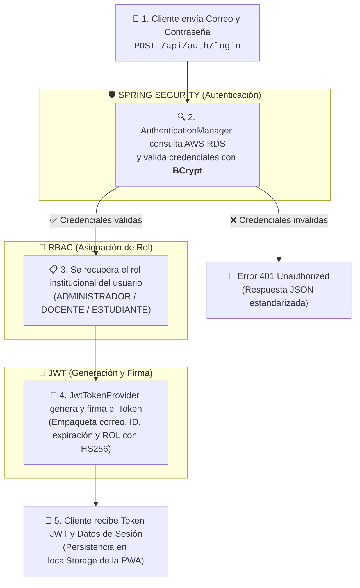

# Documento de Arquitectura de Seguridad — Entrega 3
## Sistema de Gestión de Tutorías Universitarias (SGTU)

**Curso:** Electiva Profesional II  
**Programa:** Ingeniería de Sistemas  
**Institución:** Corporación Universitaria Antonio José de Sucre (UNIAJS)  
**Semana:** 8  
**Fecha:** Noviembre 2026  
**Repositorio Oficial:** [https://github.com/WRivxs/SGTU-Tutorias-Universitarias](https://github.com/WRivxs/SGTU-Tutorias-Universitarias)  
**Despliegue Backend (API Cloud):** [https://sgtu-tutorias-universitarias.onrender.com](https://sgtu-tutorias-universitarias.onrender.com)  
**Swagger UI Oficial:** [https://sgtu-tutorias-universitarias.onrender.com/swagger-ui/index.html](https://sgtu-tutorias-universitarias.onrender.com/swagger-ui/index.html)  

**Integrantes del Equipo:**
- Wadid Rivas Payares (Encargado Backend & Arquitectura)
- Azael Espitia Toribio (Encargado Base de Datos / AWS RDS)
- Eduardo Julio Bettin Avilez (Líder Técnico / Frontend)
- Jhon Jader Bertel Ortega (Encargado QA / Documentación)

---

## 1. Introducción y Objetivos de la Entrega 3

El **Sistema de Gestión de Tutorías Universitarias (SGTU)** implementa un modelo de seguridad empresarial robusto, sin estado (**Stateless**) y basado en los estándares RFC más exigentes de la industria para APIs RESTful empresariales.

### Objetivos Clave de Seguridad Implementados:
1. **Confidencialidad y Aislamiento:** Garantizar que los recursos sensibles y académicos solo sean accesibles por los actores autorizados según su rol institucional.
2. **Autenticación Criptográfica:** Verificación de identidad mediante JSON Web Tokens (JWT) firmados con algoritmo HMAC-SHA256 (`HS256`) y contraseñas cifradas unidireccionalmente con `BCrypt` (factor de costo 10).
3. **Control de Acceso Basado en Roles (RBAC):** Restricción declarativa a nivel de método con anotaciones `@PreAuthorize` para los tres roles del sistema: `ADMINISTRADOR`, `DOCENTE` y `ESTUDIANTE`.
4. **Respuestas de Error Estandarizadas (RFC 7807):** Formato JSON uniforme en códigos HTTP 400, 401, 403, 404, 409 y 500 gestionados centralizadamente mediante `@RestControllerAdvice`, sin exposición de stacktraces internos.
5. **CORS Restringido:** Configuración explícita de orígenes autorizados para prevenir peticiones cruzadas no confiables hacia el backend en la nube.

---

## 2. Decisiones de Diseño y Fundamentos Arquitectónicos

| Decisión de Diseño | Alternativa Descartada | Justificación Técnica |
|---|---|---|
| **Arquitectura Stateless (JWT)** | Sesiones HTTP (`JSESSIONID` con cookies) | Permite escalabilidad horizontal en la nube sin compartir memoria de sesión entre instancias, desacoplamiento total cliente-servidor (SPA/PWA Angular en Vercel) y mitigación de ataques CSRF. |
| **Firma HMAC-SHA256 (HS256)** | RSA asimétrico (RS256) | Para una arquitectura monolítica modular donde el mismo servicio emite y valida los tokens, HS256 ofrece el mejor rendimiento computacional en validación con clave secreta de alta entropía. |
| **BCrypt Hashing (10 rounds)** | SHA-256 / MD5 con Salt | BCrypt implementa una función de derivación de clave adaptativa (slow-hash) resistente a ataques por fuerza bruta mediante GPU y tablas arcoíris. |
| **Autorización Declarativa (`@PreAuthorize`)** | Seguridad manual por `HttpServletRequest` | Garantiza que las reglas de autorización residan junto al código del negocio en cada controlador, evitando accesos accidentales ante cambios de rutas. |
| **Respuestas JSON en 401 y 403** | Páginas de error HTML por defecto de Spring | Evita la rotura del parser JSON en clientes móviles/SPA y asegura una experiencia de usuario consistente mediante `JwtAuthEntryPoint`. |
| **Persistencia Relacional en AWS RDS** | Base de datos local embebida | Garantiza alta disponibilidad, copias de seguridad automáticas y aislamiento de red en la nube mediante MySQL 8. |

---

## 3. Modelo Institucional Estricto y Matriz RBAC

De acuerdo con las reglas de negocio académicas:
1. **Sin auto-registro público:** No existe creación libre de cuentas anónimas. El único endpoint público del módulo de autenticación es `POST /api/auth/login`.
2. **Creación centralizada de identidades:** La creación de usuarios está reservada exclusivamente para el `ADMINISTRADOR` mediante `POST /api/usuarios`.
3. **Especialización de roles:**
   - `ADMINISTRADOR`: Acceso irrestricto, auditoría, gestión de facultades, programas, materias, usuarios, docentes y estudiantes.
   - `DOCENTE`: Consulta de asignaturas de su perfil, publicación de horarios de tutoría, consulta y respuesta (aceptar/rechazar) de solicitudes recibidas.
   - `ESTUDIANTE`: Consulta de catálogo de tutorías disponibles, solicitud de cupos de asesoría académica y seguimiento de sus propias solicitudes.

### Matriz Detallada de Permisos RBAC

| Módulo / Endpoint | Método HTTP | Roles Autorizados | Regla de Autorización (`@PreAuthorize`) |
|---|:---:|---|---|
| `/api/auth/login` | POST | **Público** | `permitAll()` |
| `/api/usuarios` | GET, POST | `ADMINISTRADOR` | `hasRole('ADMINISTRADOR')` |
| `/api/usuarios/{id}` | GET | `ADMINISTRADOR`, `DOCENTE`, `ESTUDIANTE` | Autenticado (perfil propio / auditoría) |
| `/api/usuarios/{id}` | PUT, DELETE | `ADMINISTRADOR` | `hasRole('ADMINISTRADOR')` |
| `/api/usuarios/{id}/estado` | PATCH | `ADMINISTRADOR` | `hasRole('ADMINISTRADOR')` |
| `/api/facultades` | GET | `ADMINISTRADOR`, `DOCENTE`, `ESTUDIANTE` | Autenticado |
| `/api/facultades/**` | POST, PUT, DELETE | `ADMINISTRADOR` | `hasRole('ADMINISTRADOR')` |
| `/api/programas` | GET | `ADMINISTRADOR`, `DOCENTE`, `ESTUDIANTE` | Autenticado |
| `/api/programas/**` | POST, PUT, DELETE | `ADMINISTRADOR` | `hasRole('ADMINISTRADOR')` |
| `/api/materias` | GET | `ADMINISTRADOR`, `DOCENTE`, `ESTUDIANTE` | Autenticado |
| `/api/materias/**` | POST, PUT, DELETE | `ADMINISTRADOR` | `hasRole('ADMINISTRADOR')` |
| `/api/docentes` | GET | `ADMINISTRADOR`, `DOCENTE`, `ESTUDIANTE` | Autenticado |
| `/api/docentes` | POST, DELETE | `ADMINISTRADOR` | `hasRole('ADMINISTRADOR')` |
| `/api/docentes/{id}` | PUT | `ADMINISTRADOR`, `DOCENTE` | `hasRole('ADMINISTRADOR') or hasRole('DOCENTE')` |
| `/api/docentes/{id}/materias/**` | POST, DELETE | `ADMINISTRADOR` | `hasRole('ADMINISTRADOR')` |
| `/api/estudiantes` | GET | `ADMINISTRADOR`, `DOCENTE` | `hasRole('ADMINISTRADOR') or hasRole('DOCENTE')` |
| `/api/estudiantes/{id}` | GET | `ADMINISTRADOR`, `DOCENTE`, `ESTUDIANTE` | Autenticado |
| `/api/estudiantes/**` | POST, DELETE | `ADMINISTRADOR` | `hasRole('ADMINISTRADOR')` |
| `/api/estudiantes/{id}` | PUT | `ADMINISTRADOR`, `ESTUDIANTE` | `hasRole('ADMINISTRADOR') or hasRole('ESTUDIANTE')` |
| `/api/tutorias` | GET | `ADMINISTRADOR`, `DOCENTE`, `ESTUDIANTE` | Autenticado |
| `/api/tutorias` | POST, PUT, DELETE | `ADMINISTRADOR`, `DOCENTE` | `hasRole('ADMINISTRADOR') or hasRole('DOCENTE')` |
| `/api/tutorias/{id}/estado` | PATCH | `ADMINISTRADOR`, `DOCENTE` | `hasRole('ADMINISTRADOR') or hasRole('DOCENTE')` |
| `/api/solicitudes` | GET | `ADMINISTRADOR`, `DOCENTE`, `ESTUDIANTE` | Autenticado (filtrado por rol) |
| `/api/solicitudes` | POST | `ESTUDIANTE` | `hasRole('ESTUDIANTE')` |
| `/api/solicitudes/{id}/responder` | PATCH | `ADMINISTRADOR`, `DOCENTE` | `hasRole('ADMINISTRADOR') or hasRole('DOCENTE')` |
| `/api/solicitudes/{id}` | DELETE | `ADMINISTRADOR`, `ESTUDIANTE` | `hasRole('ADMINISTRADOR') or hasRole('ESTUDIANTE')` |
| `/swagger-ui/**`, `/v3/api-docs/**` | GET | **Público** | `permitAll()` |

---

## 4. Flujo de Autenticación y Emisión de Tokens (Login)



---

## 5. Pipeline de Peticiones Protegidas y Validación de Tokens


---

## 6. Manejo Centralizado de Excepciones y Estándar RFC 7807

La aplicación implementa la clase global `@RestControllerAdvice` (`GlobalExceptionHandler`), asegurando que todos los errores se serialicen bajo un contrato uniforme:

```json
{
  "timestamp": "2026-11-08T17:15:30.123",
  "status": 403,
  "error": "Forbidden",
  "message": "Acceso denegado: se requieren privilegios de DOCENTE o ADMINISTRADOR",
  "path": "/api/tutorias"
}
```

### Catálogo de Excepciones Mapeadas:
* **`MethodArgumentNotValidException` (400 Bad Request):** Violación de restricciones `@NotBlank`, `@Email`, `@Min`, `@Max`. Devuelve mapa detallado `errores: { campo: mensaje }`.
* **`BadCredentialsException` / `AuthenticationException` (401 Unauthorized):** Credenciales erróneas o token JWT expirado/inválido.
* **`AccessDeniedException` (403 Forbidden):** Usuario autenticado intentando acceder a una operación fuera de su rol.
* **`ResourceNotFoundException` (404 Not Found):** Identificador de entidad no existente en la base de datos.
* **`ConflictException` (409 Conflict):** Violación de unicidad (correo duplicado, código de asignatura existente o tutoría ocupada).
* **`Exception` general (500 Internal Server Error):** Errores no controlados con enmascaramiento seguro del mensaje técnico.

---

## 7. Documentación Interactiva OpenAPI 3.0 / Swagger UI

Para facilitar la auditoría, integración con el Frontend y evaluación docente, la API cuenta con documentación interactiva autogenerada:

* **URL Pública:** [https://sgtu-tutorias-universitarias.onrender.com/swagger-ui/index.html](https://sgtu-tutorias-universitarias.onrender.com/swagger-ui/index.html)
* **Especificación OpenAPI (JSON):** `https://sgtu-tutorias-universitarias.onrender.com/v3/api-docs`
* **Soporte de Autenticación en Swagger:** Botón **Authorize** habilitado con soporte para prefijo `Bearer <token>` en todas las pruebas interactivas.
