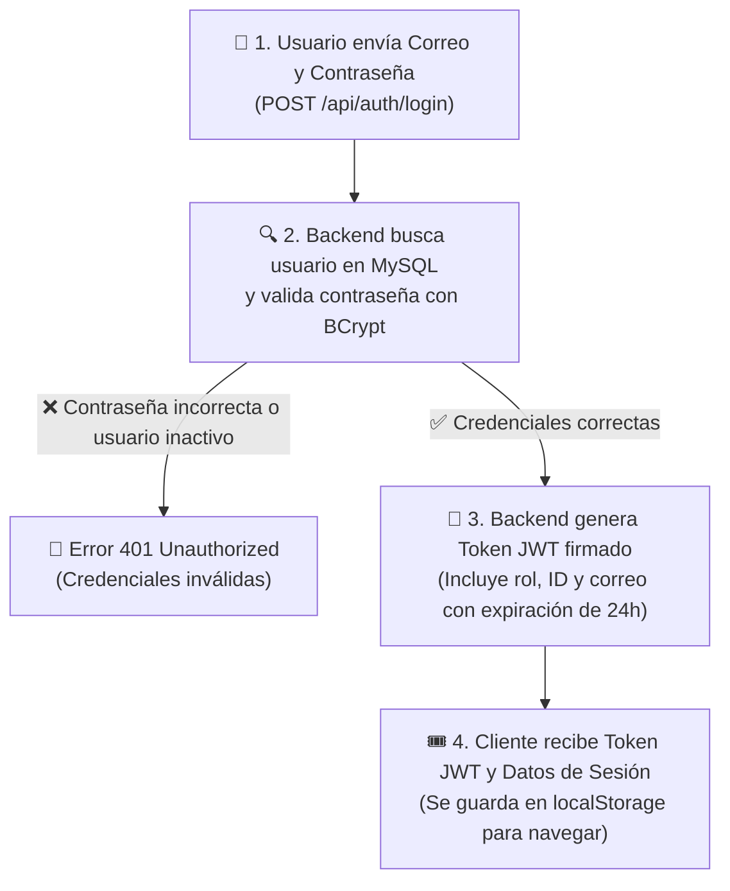
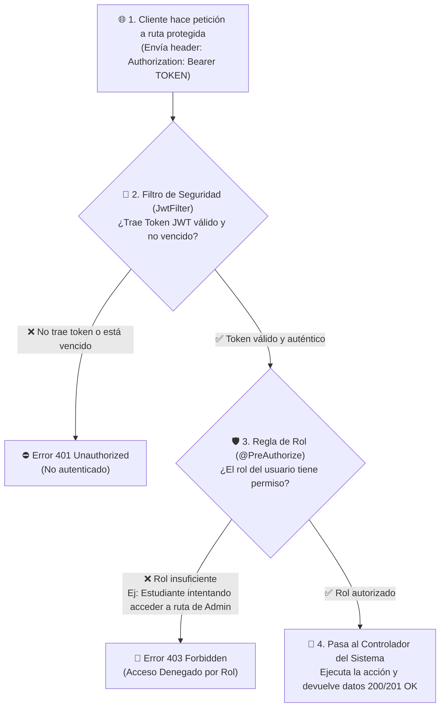

# Documento de Arquitectura de Seguridad — Entrega 3
## Sistema de Gestión de Tutorías Universitarias (SGTU)

**Semana:** 8  
**Fecha:** Octubre 2026  
**Integrantes:**
- Wadid Rivas Payares (Encargado Backend & Arquitectura)
- Azael Espitia Toribio (Encargado Base de Datos / AWS RDS)
- Eduardo Julio Bettin Avilez (Líder Técnico / Frontend)
- Jhon Jader Bertel Ortega (Encargado QA / Documentación)

---

## 1. Introducción y Objetivos de la Entrega 3

El **Sistema de Gestión de Tutorías Universitarias (SGTU)** implementa un modelo de seguridad empresarial robusto, sin estado (**Stateless**) y basado en los estándares RFC más exigentes de la industria para APIs RESTful.

### Objetivos Clave de Seguridad:
1. **Confidencialidad:** Garantizar que los recursos sensibles solo sean accesibles por los actores autorizados según su rol institucional.
2. **Autenticación Fuerte:** Verificación criptográfica mediante JSON Web Tokens (JWT) y cifrado unidireccional de contraseñas.
3. **Control de Acceso Basado en Roles (RBAC):** Restricción declarativa a nivel de método y de endpoint para los tres roles del sistema (`ADMINISTRADOR`, `TUTOR`, `ESTUDIANTE`).
4. **Respuestas de Error Estandarizadas:** Formato JSON uniforme compatible con RFC 7807 sin exposición de stacktraces internos.

---

## 2. Decisiones de Diseño y Fundamentos Arquitectónicos

| Decisión de Diseño | Alternativa Descartada | Justificación Técnica |
|---|---|---|
| **Arquitectura Stateless (JWT)** | Sesiones HTTP (JSESSIONID con cookies) | Permite escalabilidad horizontal sin necesidad de compartir memoria de sesión entre instancias, desacoplamiento total cliente-servidor (SPA Angular / Móvil) y eliminación natural de vulnerabilidades CSRF. |
| **Firma HMAC-SHA256 (HS256)** | RSA asimétrico (RS256) | Para una arquitectura monolítica modular donde el mismo servicio emite y valida los tokens, HS256 ofrece un rendimiento óptimo de verificación con mínimo overhead computacional. |
| **BCrypt Hashing (10 rounds)** | SHA-256 / MD5 con Salt | BCrypt implementa una función de derivación de clave adaptativa (slow-hash) resistente a ataques por fuerza bruta mediante GPU y tablas arcoíris. |
| **Autorización Declarativa (`@PreAuthorize`)** | Seguridad manual por `HttpServletRequest` | Garantiza que las reglas de autorización residan junto al código del negocio, evitando bypasses accidentales ante cambios de ruta. |
| **Respuestas JSON en 401 y 403** | Páginas de error HTML por defecto de Spring | Evita la rotura del parser JSON en el cliente Frontend y asegura una experiencia de usuario consistente. |

---

## 3. Modelo Institucional Estricto y Matriz RBAC

De acuerdo con las reglas de negocio de una institución universitaria:
1. **Sin auto-registro público:** No existe creación libre de cuentas anónimas. El único endpoint público del módulo de autenticación es `POST /api/auth/login`.
2. **Creación centralizada:** La creación de cualquier usuario (Estudiantes, Tutores u otros Administradores) está reservada exclusivamente para el `ADMINISTRADOR` mediante `POST /api/usuarios`.
3. **Roles implementados:**
   - `ADMINISTRADOR`: Acceso irrestricto, auditoría, gestión de usuarios, materias y supervisión global.
   - `TUTOR`: Programación y gestión de sesiones grupales, consulta de materias y aceptación/rechazo de solicitudes de estudiantes.
   - `ESTUDIANTE`: Consulta de materias, catálogo de tutorías disponibles, solicitud de cupos y seguimiento de sus propias inscripciones.

### Matriz Detallada de Permisos RBAC

| Módulo / Endpoint | Método | Roles Autorizados | Regla de Autorización (@PreAuthorize) |
|---|---|---|---|
| `/api/auth/login` | POST | **Público** | `permitAll()` |
| `/api/usuarios` | GET, POST | `ADMINISTRADOR` | `hasRole('ADMINISTRADOR')` |
| `/api/usuarios/{id}` | GET | `ADMINISTRADOR`, `TUTOR`, `ESTUDIANTE` | Autenticado (ver perfil propio / admin) |
| `/api/usuarios/{id}` | PUT, DELETE | `ADMINISTRADOR` | `hasRole('ADMINISTRADOR')` |
| `/api/usuarios/{id}/estado` | PATCH | `ADMINISTRADOR` | `hasRole('ADMINISTRADOR')` |
| `/api/materias` | GET | `ADMINISTRADOR`, `TUTOR`, `ESTUDIANTE` | Autenticado |
| `/api/materias` | POST, PUT, DELETE | `ADMINISTRADOR` | `hasRole('ADMINISTRADOR')` |
| `/api/tutores/**` | GET | `ADMINISTRADOR`, `TUTOR`, `ESTUDIANTE` | Autenticado |
| `/api/tutores` | POST, DELETE | `ADMINISTRADOR` | `hasRole('ADMINISTRADOR')` |
| `/api/tutores/{id}` | PUT | `ADMINISTRADOR`, `TUTOR` | `hasRole('ADMINISTRADOR') or hasRole('TUTOR')` |
| `/api/tutorias` | GET | `ADMINISTRADOR`, `TUTOR`, `ESTUDIANTE` | Autenticado |
| `/api/tutorias` | POST, PUT, DELETE | `ADMINISTRADOR`, `TUTOR` | `hasRole('ADMINISTRADOR') or hasRole('TUTOR')` |
| `/api/tutorias/{id}/estado` | PATCH | `ADMINISTRADOR`, `TUTOR` | `hasRole('ADMINISTRADOR') or hasRole('TUTOR')` |
| `/api/solicitudes` | GET | `ADMINISTRADOR`, `TUTOR`, `ESTUDIANTE` | Autenticado |
| `/api/solicitudes` | POST | `ESTUDIANTE` | `hasRole('ESTUDIANTE')` |
| `/api/solicitudes/{id}/responder` | PATCH | `ADMINISTRADOR`, `TUTOR` | `hasRole('ADMINISTRADOR') or hasRole('TUTOR')` |
| `/api/solicitudes/{id}` | DELETE | `ADMINISTRADOR`, `ESTUDIANTE` | `hasRole('ADMINISTRADOR') or hasRole('ESTUDIANTE')` |
| `/swagger-ui/**`, `/v3/api-docs/**` | GET | **Público** | `permitAll()` |

---

## 4. Flujo de Autenticación y Emisión de Tokens (Login)



---

## 5. Pipeline de Peticiones Protegidas y Validación de Tokens



---

## 6. Estructura y Anatomía del Token JWT (RFC 7519)

El token emitido por el sistema sigue la estructura estándar compacta de 3 partes separadas por puntos (`header.payload.signature`):

### 1. Header:
```json
{
  "alg": "HS256",
  "typ": "JWT"
}
```

### 2. Payload (Claims Institucionales):
```json
{
  "sub": "wadid.tutor@tutorias.com",
  "userId": 2,
  "role": "ROLE_TUTOR",
  "nombre": "Wadid Rivas",
  "iat": 1729180800,
  "exp": 1729267200
}
```
* **`sub` (Subject):** Correo electrónico institucional del usuario autenticado.
* **`userId`:** Identificador único de clave primaria en la base de datos relacional.
* **`role`:** Rol asignado con el prefijo obligatorio `ROLE_` requerido por Spring Security.
* **`nombre`:** Nombre y apellido para visualización amigable en el cliente sin requerir consultas extra.
* **`iat` (Issued At):** Timestamp UNIX del momento exacto de emisión.
* **`exp` (Expiration Time):** Timestamp UNIX de expiración (24 horas después de emitido).

### 3. Signature:
Generada mediante el algoritmo HMAC-SHA256:
$$\text{Signature} = \text{HMAC-SHA256}(\text{base64UrlEncode}(\text{Header}) + \text{"."} + \text{base64UrlEncode}(\text{Payload}), \text{JWT\_SECRET})$$

---

## 7. Manejo Centralizado de Excepciones de Seguridad

Toda violación de seguridad o fallo de validación es capturado y transformado en una respuesta JSON predecible sin exponer información sensible del servidor:

### Error 401 Unauthorized (`JwtAuthEntryPoint`):
Se dispara cuando el cliente intenta acceder a una ruta protegida sin token, con un token vencido o con credenciales erróneas en el login:
```json
{
  "timestamp": "2026-10-17T15:00:00",
  "status": 401,
  "error": "Unauthorized",
  "message": "Acceso no autorizado: credenciales inválidas o token no proporcionado / expirado",
  "path": "/api/tutorias"
}
```

### Error 403 Forbidden (`CustomAccessDeniedHandler`):
Se dispara cuando el token es válido y está autenticado, pero el rol del usuario no tiene los privilegios necesarios según `@PreAuthorize`:
```json
{
  "timestamp": "2026-10-17T15:00:00",
  "status": 403,
  "error": "Forbidden",
  "message": "Acceso denegado: no cuenta con los permisos o rol requeridos para esta acción",
  "path": "/api/usuarios"
}
```

---

## 8. Análisis de Mitigación de Vulnerabilidades (OWASP Top 10)

| Vulnerabilidad OWASP | Riesgo Potencial | Estrategia de Mitigación en SGTU |
|---|---|---|
| **A01: Broken Access Control** | Un estudiante manipulando solicitudes ajenas o accediendo a rutas administrativas. | Control estricto mediante `@PreAuthorize` en cada endpoint y verificación de propiedad en la capa de servicios (`existsByEstudianteIdAndTutoriaId`). |
| **A02: Cryptographic Failures** | Robo o exposición de contraseñas almacenadas. | Almacenamiento exclusivo con **BCrypt (factor de coste 10)**. Las contraseñas en texto claro nunca se guardan ni se retornan en las entidades (`@JsonProperty(access = WRITE_ONLY)`). |
| **A03: Injection (SQLi)** | Inyección de SQL mediante parámetros de búsqueda. | Uso estricto de **Spring Data JPA y Hibernate** con consultas parametrizadas automáticas. Prohibición de concatenación de SQL directo. |
| **A07: Identification and Authentication Failures** | Ataques de repetición o tokens manipulados. | Verificación de firma criptográfica con secreto de 256 bits, validación estricta de tiempo de expiración y manejo de tokens sin estado. |

---

## 9. Evidencia de Pruebas y Validación

La arquitectura de seguridad ha sido exhaustivamente comprobada mediante:

1. **17 Pruebas Unitarias Automatizadas en JUnit 5 / Mockito:**
   - Cobertura de autenticación exitosa, credenciales erróneas y cuentas inactivas (`AuthServiceTest`).
   - Validación de hashes y roles en `UsuarioServiceTest`.
2. **17 Pruebas de Integración Automatizadas en Postman:**
   - Ejecución de la colección `SGTU-API-Entrega3.postman_collection.json`.
   - Verificación de status codes esperados (`200`, `201`, `400`, `401`, `403`, `404`).
   - Pruebas negativas: intento de acceso a `/api/usuarios` con token de Estudiante (resultado esperado: `403 Forbidden`).
   - Pruebas negativas: llamada sin cabecera `Authorization` (resultado esperado: `401 Unauthorized`).
3. **Swagger OpenAPI 3 Interactivo:**
   - Configuración de seguridad global `bearerAuth` en `/swagger-ui/index.html`.
