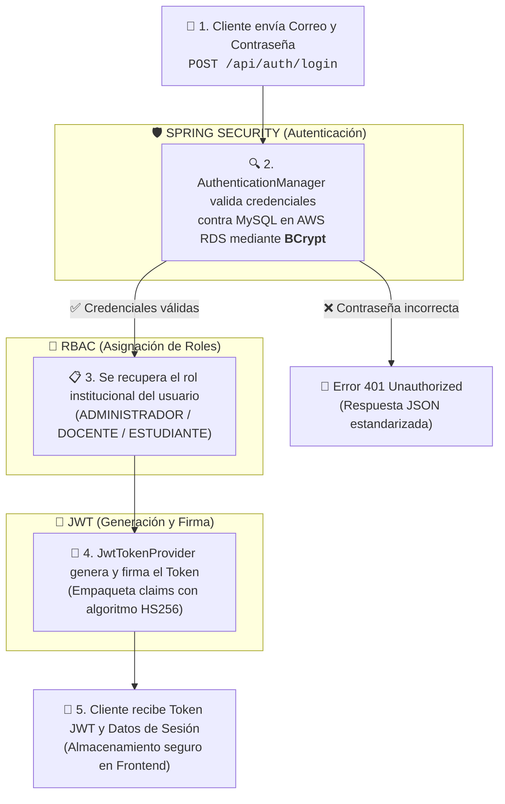
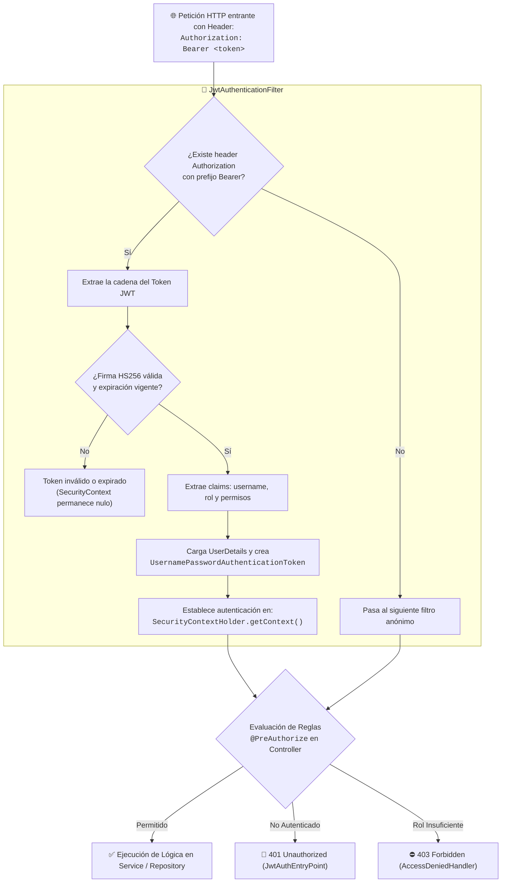

# Documento de Arquitectura de Seguridad y Backend Completo — Entrega 3
## Sistema de Gestión de Tutorías Universitarias (SGTU)

**Curso:** Electiva Profesional II  
**Programa:** Ingeniería de Sistemas  
**Institución:** Corporación Universitaria Antonio José de Sucre (UNIAJS)  
**Semana del Cronograma:** Semana 8  
**Fecha:** Noviembre 2026  
**Repositorio Oficial (GitHub):** [https://github.com/WRivxs/SGTU-Tutorias-Universitarias](https://github.com/WRivxs/SGTU-Tutorias-Universitarias)  
**API en Vivo (Cloud Render):** [https://sgtu-tutorias-universitarias.onrender.com](https://sgtu-tutorias-universitarias.onrender.com)  
**Documentación Interactiva Swagger UI:** [https://sgtu-tutorias-universitarias.onrender.com/swagger-ui/index.html](https://sgtu-tutorias-universitarias.onrender.com/swagger-ui/index.html)  

**Integrantes del Equipo de Desarrollo:**
* **Wadid Rivas Payares** — *Encargado de Backend, Arquitectura y Servicios REST*
* **Azael Espitia Toribio** — *Encargado de Base de Datos y Persistencia (AWS RDS)*
* **Eduardo Julio Bettin Avilez** — *Líder Técnico e Integración de Sistemas*
* **Jhon Jader Bertel Ortega** — *Encargado de Calidad (QA), Pruebas y Documentación*

---

## 1. Introducción y Alcance de la Entrega 3

El **Sistema de Gestión de Tutorías Universitarias (SGTU)** tiene como misión optimizar y centralizar el proceso de acompañamiento académico entre estudiantes y docentes tutores. En esta tercera entrega se consolidó la totalidad del **Backend**, proveyendo una arquitectura empresarial basada en servicios web RESTful, operaciones CRUD para todas las entidades del modelo académico universitario, mecanismos criptográficos de autenticación mediante JSON Web Tokens (JWT) y una estricta política de Control de Acceso Basado en Roles (RBAC).

### Objetivos Clave de la Entrega Alcanzados:
1. **CRUD Integral y Relaciones JPA:** Cobertura del 100% de operaciones de creación, consulta, actualización y eliminación sobre las entidades del sistema (`facultades`, `programas`, `materias`, `usuarios`, `docentes`, `estudiantes`, `tutorias`, `solicitudes`).
2. **Seguridad Stateless (Sin Estado):** Implementación de Spring Security 6 junto con filtros interceptores para procesar tokens JWT sin dependencia de sesiones en el servidor (`JSESSIONID`).
3. **Control de Acceso Declarativo (RBAC):** Restricción granular a nivel de método con `@PreAuthorize` para tres roles institucionales: `ADMINISTRADOR`, `DOCENTE` y `ESTUDIANTE`.
4. **Validaciones Fuertes de Entrada:** Validación de integridad en todas las peticiones entrantes mediante la especificación Jakarta Validation (`@Valid`).
5. **Manejo Centralizado de Excepciones:** Respuestas de error estandarizadas bajo el estándar **RFC 7807 (Problem Details)** sin fuga de información técnica o trazas internas de la base de datos.
6. **Pruebas Automatizadas y Documentación:** Colección exportada de Postman con más de 20 aserciones automatizadas (`pm.test`), reporte de ejecución Newman y documentación interactiva autogenerada con Swagger / OpenAPI 3.

---

## 2. Ficha Técnica del Stack Tecnológico Implementado

| Componente | Tecnología / Librería | Versión | Rol en el Sistema |
|---|---|:---:|---|
| **Lenguaje de Programación** | Java (OpenJDK) | 17 / 21 LTS | Lenguaje base orientado a objetos fuertemente tipado. |
| **Framework de Aplicación** | Spring Boot | 3.3.x | Contenedor de inversión de control, inyección de dependencias y configuración automática. |
| **Capa de Seguridad** | Spring Security | 6.x | Pipeline de filtros de autenticación, autorización y encriptación. |
| **Tokens Criptográficos** | Java JWT (`jjwt-api`, `jjwt-impl`) | 0.11.5 | Generación, firma digital (HMAC-SHA256) y validación de tokens de acceso. |
| **Cifrado de Contraseñas** | BCryptPasswordEncoder | 10 rounds | Función de hash unidireccional adaptativa resistente a ataques por fuerza bruta. |
| **Capa de Persistencia** | Spring Data JPA / Hibernate | 6.x | Mapeo objeto-relacional (ORM), repositorios y transaccionalidad. |
| **Base de Datos en la Nube** | Amazon Web Services (AWS RDS) | MySQL 8.0 | Motor relacional gestionado de alta disponibilidad. |
| **Servidor y Contenedor** | Docker + Render Cloud | Linux Alpine | Entorno de ejecución containerizado y accesible públicamente vía HTTPS. |
| **Documentación de API** | Springdoc OpenAPI / Swagger UI | 2.5.x | Generación dinámica de la especificación OpenAPI 3.0. |
| **Validaciones** | Hibernate Validator (Jakarta) | 8.x | Validación declarativa de atributos de entrada en DTOs y entidades. |

---

## 3. Arquitectura Modular por Capas (Layered Architecture)

El backend de SGTU implementa el patrón clásico de **Arquitectura en Cuatro Capas**, asegurando una estricta separación de responsabilidades y facilitando el mantenimiento y las pruebas unitarias:

```mermaid
flowchart TD
    subgraph Client ["🌐 CLIENTES Y CONSUMIDORES"]
        A1["📱 Aplicación Web Progresiva (Angular en Vercel)"]
        A2["🧪 Suite de Pruebas (Postman / Newman)"]
        A3["📖 Swagger UI / OpenAPI Docs"]
    end

    subgraph SecurityLayer ["🛡️ CAPA DE FILTROS Y SEGURIDAD"]
        B1["CorsFilter (Orígenes Permitidos)"]
        B2["JwtAuthenticationFilter (Validación Bearer Token)"]
        B3["SecurityContextHolder (Asignación de Principal y Roles)"]
    end

    subgraph ControllerLayer ["🎮 CAPA DE CONTROLADORES (@RestController)"]
        C1["AuthController (/api/auth)"]
        C2["UsuarioController (/api/usuarios)"]
        C3["FacultadController (/api/facultades)"]
        C4["ProgramaController (/api/programas)"]
        C5["MateriaController (/api/materias)"]
        C6["DocenteController (/api/docentes)"]
        C7["EstudianteController (/api/estudiantes)"]
        C8["TutoriaController (/api/tutorias)"]
        C9["SolicitudController (/api/solicitudes)"]
    end

    subgraph ServiceLayer ["⚙️ CAPA DE LÓGICA DE NEGOCIO (@Service)"]
        D1["AuthService, UsuarioService, MateriaService, TutoriaService, SolicitudService..."]
        D2["Validaciones de Negocio, Transacciones Atómicas (@Transactional), DTO Mapping"]
    end

    subgraph RepositoryLayer ["💾 CAPA DE ACCESO A DATOS (@Repository)"]
        E1["Spring Data JPA Repositories (CrudRepository, JpaRepository)"]
        E2["Consultas Derivadas, Índices y Mapeo de Entidades Relacionales"]
    end

    subgraph DatabaseLayer ["☁️ INFRAESTRUCTURA EN LA NUBE"]
        F1[("AWS RDS MySQL 8 (tutorias_db)")]
    end

    Client --> SecurityLayer
    SecurityLayer --> ControllerLayer
    ControllerLayer --> ServiceLayer
    ServiceLayer --> RepositoryLayer
    RepositoryLayer --> DatabaseLayer
```



### Organización de Paquetes en el Proyecto:
* `com.uas.tutorias.controller`: Puntos de entrada HTTP, mapeo de endpoints y anotaciones de seguridad `@PreAuthorize`.
* `com.uas.tutorias.service`: Interfaces e implementaciones con la lógica de negocio y control de transacciones.
* `com.uas.tutorias.repository`: Interfaces JPA para comunicación directa con la base de datos MySQL.
* `com.uas.tutorias.entity`: Clases entidad con anotaciones JPA (`@Entity`, `@Table`, `@ManyToOne`, `@ManyToMany`).
* `com.uas.tutorias.dto`: Objetos de transferencia de datos para peticiones (`request`) y respuestas (`response`).
* `com.uas.tutorias.security`: Filtro JWT, proveedor de tokens, UserDetailsService y configuración de Spring Security.
* `com.uas.tutorias.exception`: Manejador global de excepciones (`GlobalExceptionHandler`) y excepciones personalizadas.

---

## 4. Decisiones de Diseño y Fundamentos de Seguridad

| Decisión de Diseño | Alternativa Descartada | Justificación de Ingeniería de Software |
|---|---|---|
| **Arquitectura Stateless (JWT)** | Sesiones HTTP tradicionales (`JSESSIONID`) | Permite escalabilidad horizontal en la nube sin sincronización de sesión en memoria, desacoplamiento absoluto de clientes frontend y móviles, y eliminación natural de ataques CSRF. |
| **Firma HMAC-SHA256 (`HS256`)** | Firmas asimétricas RSA (RS256) | Para una arquitectura monolítica donde el mismo servicio genera y valida sus propios tokens, HS256 ofrece el menor costo de procesamiento computacional y latencias mínimas. |
| **BCrypt Hashing (10 Rounds)** | SHA-256 / MD5 con Salt | BCrypt implementa una función de derivación de clave adaptativa (slow-hash) resistente a ataques por fuerza bruta mediante GPU y tablas arcoíris. |
| **Autorización Declarativa (`@PreAuthorize`)** | Verificación manual con `HttpServletRequest` | Garantiza que las reglas de autorización residan junto al código del negocio en cada método del controlador, evitando bypasses accidentales ante modificaciones de rutas. |
| **Respuestas JSON en 401 y 403** | Páginas de error HTML por defecto de Spring | Evita la rotura del parser JSON en el frontend y garantiza una experiencia de usuario consistente mediante `JwtAuthEntryPoint` y `CustomAccessDeniedHandler`. |
| **Persistencia en AWS RDS** | Base de datos local SQLite o MySQL local | Garantiza alta disponibilidad en la nube, copias de seguridad automáticas y aislamiento de red accesible únicamente mediante credenciales encriptadas. |

---

## 5. Modelo Institucional Estricto y Matriz RBAC

De acuerdo con las reglas de negocio de una institución de educación superior:
1. **Sin auto-registro anónimo:** No existe creación pública de cuentas no auditadas. El único endpoint público del módulo de autenticación es `POST /api/auth/login`.
2. **Creación centralizada de identidades:** El registro de nuevos usuarios está reservado exclusivamente para el `ADMINISTRADOR` mediante `POST /api/usuarios`.
3. **Especialización funcional de roles:**
   - **`ADMINISTRADOR`:** Acceso global irrestricto, auditoría de usuarios, gestión de la estructura académica (facultades, programas, materias), y administración de perfiles docentes y estudiantiles.
   - **`DOCENTE`:** Consulta de las asignaturas asignadas a su perfil, publicación de sesiones de tutoría con definición de cupos y horarios, y revisión/aprobación de solicitudes de estudiantes.
   - **`ESTUDIANTE`:** Consulta del catálogo de tutorías disponibles, solicitud de cupos de asesoría académica y seguimiento en tiempo real del estado de sus peticiones.

### Matriz Detallada de Permisos RBAC

| Módulo / Endpoint | Método HTTP | Roles Autorizados | Regla de Autorización (`@PreAuthorize`) |
|---|:---:|---|---|
| `/api/auth/login` | POST | **Público** | `permitAll()` |
| `/api/usuarios` | GET, POST | `ADMINISTRADOR` | `hasRole('ADMINISTRADOR')` |
| `/api/usuarios/{id}` | GET | `ADMINISTRADOR`, `DOCENTE`, `ESTUDIANTE` | Autenticado (ver perfil propio / auditoría) |
| `/api/usuarios/{id}` | PUT, DELETE | `ADMINISTRADOR` | `hasRole('ADMINISTRADOR')` |
| `/api/usuarios/{id}/estado` | PATCH | `ADMINISTRADOR` | `hasRole('ADMINISTRADOR')` |
| `/api/facultades` | GET | `ADMINISTRADOR`, `DOCENTE`, `ESTUDIANTE` | Autenticado |
| `/api/facultades/**` | POST, PUT, DELETE | `ADMINISTRADOR` | `hasRole('ADMINISTRADOR')` |
| `/api/programas` | GET | `ADMINISTRADOR`, `DOCENTE`, `ESTUDIANTE` | Autenticado |
| `/api/programas/**` | POST, PUT, DELETE | `ADMINISTRADOR` | `hasRole('ADMINISTRADOR')` |
| `/api/materias` | GET | `ADMINISTRADOR`, `DOCENTE`, `ESTUDIANTE` | Autenticado |
| `/api/materias/**` | POST, PUT, DELETE | `ADMINISTRADOR` | `hasRole('ADMINISTRADOR')` |
| `/api/docentes` | GET | `ADMINISTRADOR`, `DOCENTE`, `ESTUDIANTE` | Autenticado |
| `/api/docentes` | POST, DELETE | `ADMINISTRADOR` | `hasRole('ADMINISTRADOR')` |
| `/api/docentes/{id}` | PUT | `ADMINISTRADOR`, `DOCENTE` | `hasRole('ADMINISTRADOR') or hasRole('DOCENTE')` |
| `/api/docentes/{id}/materias/**` | POST, DELETE | `ADMINISTRADOR` | `hasRole('ADMINISTRADOR')` |
| `/api/estudiantes` | GET | `ADMINISTRADOR`, `DOCENTE` | `hasRole('ADMINISTRADOR') or hasRole('DOCENTE')` |
| `/api/estudiantes/{id}` | GET | `ADMINISTRADOR`, `DOCENTE`, `ESTUDIANTE` | Autenticado |
| `/api/estudiantes/**` | POST, DELETE | `ADMINISTRADOR` | `hasRole('ADMINISTRADOR')` |
| `/api/estudiantes/{id}` | PUT | `ADMINISTRADOR`, `ESTUDIANTE` | `hasRole('ADMINISTRADOR') or hasRole('ESTUDIANTE')` |
| `/api/tutorias` | GET | `ADMINISTRADOR`, `DOCENTE`, `ESTUDIANTE` | Autenticado |
| `/api/tutorias` | POST, PUT, DELETE | `ADMINISTRADOR`, `DOCENTE` | `hasRole('ADMINISTRADOR') or hasRole('DOCENTE')` |
| `/api/tutorias/{id}/estado` | PATCH | `ADMINISTRADOR`, `DOCENTE` | `hasRole('ADMINISTRADOR') or hasRole('DOCENTE')` |
| `/api/solicitudes` | GET | `ADMINISTRADOR`, `DOCENTE`, `ESTUDIANTE` | Autenticado (filtrado por rol) |
| `/api/solicitudes` | POST | `ESTUDIANTE` | `hasRole('ESTUDIANTE')` |
| `/api/solicitudes/{id}/responder` | PATCH | `ADMINISTRADOR`, `DOCENTE` | `hasRole('ADMINISTRADOR') or hasRole('DOCENTE')` |
| `/api/solicitudes/{id}` | DELETE | `ADMINISTRADOR`, `ESTUDIANTE` | `hasRole('ADMINISTRADOR') or hasRole('ESTUDIANTE')` |
| `/swagger-ui/**`, `/v3/api-docs/**` | GET | **Público** | `permitAll()` |

---

## 6. Flujo de Autenticación y Ciclo de Vida del Token JWT

### 6.1 Proceso de Emisión de Tokens (Login)


### 6.2 Anatomía del Token JWT Emitido:
* **Header:**
  ```json
  {
    "alg": "HS256",
    "typ": "JWT"
  }
  ```
* **Payload (Claims de Sesión):**
  ```json
  {
    "sub": "ana.estudiante@tutorias.com",
    "id": 5,
    "rol": "ESTUDIANTE",
    "nombre": "Ana",
    "apellido": "Martínez",
    "iat": 1762624800,
    "exp": 1762711200
  }
  ```
* **Duración:** 24 horas (86,400,000 milisegundos), tras lo cual el token expira automáticamente forzando una nueva autenticación.

---

## 7. Pipeline de Validación de Peticiones Protegidas



---

## 8. Validaciones de Entrada y Manejo Centralizado de Excepciones

### 8.1 Validaciones Declarativas con Jakarta Validation
Para garantizar la integridad y sanitización de los datos antes de alcanzar la base de datos, todos los modelos de entrada implementan anotaciones estrictas:

* **En Usuarios:**
  * `@NotBlank(message = "El correo es obligatorio")`
  * `@Email(message = "El correo debe tener un formato válido")`
  * `@Size(min = 6, message = "La contraseña debe tener mínimo 6 caracteres")`
* **En Materias:**
  * `@Min(value = 1, message = "El semestre mínimo es 1")`
  * `@Max(value = 12, message = "El semestre máximo es 12")`
  * `@NotNull(message = "El programa académico es obligatorio")`
* **En Tutorías:**
  * `@NotNull(message = "La fecha es obligatoria")`
  * `@Min(value = 1, message = "El cupo mínimo debe ser 1 estudiante")`

### 8.2 Manejo Centralizado con `@RestControllerAdvice` (RFC 7807)
Todas las anomalías son capturadas centralizadamente por `GlobalExceptionHandler`, asegurando un contrato JSON estandarizado:

```json
{
  "timestamp": "2026-11-08T17:25:30.450",
  "status": 403,
  "error": "Forbidden",
  "message": "Acceso denegado: se requieren privilegios de DOCENTE o ADMINISTRADOR",
  "path": "/api/tutorias"
}
```

#### Catálogo de Excepciones Mapeadas:
* **`MethodArgumentNotValidException` (400 Bad Request):** Violación de validaciones Jakarta. Retorna un mapa `errores: { campo: "motivo" }`.
* **`BadCredentialsException` / `AuthenticationException` (401 Unauthorized):** Fallo de credenciales o token JWT vencido.
* **`AccessDeniedException` (403 Forbidden):** Intento de ejecución de endpoints sin el rol correspondiente.
* **`ResourceNotFoundException` (404 Not Found):** Identificador de entidad no existente en la base de datos.
* **`ConflictException` (409 Conflict):** Violación de unicidad de negocio (correo duplicado, tutoría sin cupos disponibles).
* **`Exception` general (500 Internal Server Error):** Errores no controlados con enmascaramiento seguro del mensaje técnico.

---

## 9. Manejo de Transacciones y Concurrencia (`@Transactional`)

En procesos críticos que involucran múltiples entidades dependientes (como la aceptación de solicitudes de tutoría), el backend hace uso de transacciones declarativas mediante la anotación `@Transactional`:

```java
@Transactional
public Solicitud responderSolicitud(Long idSolicitud, EstadoSolicitud nuevoEstado, String comentario) {
    Solicitud solicitud = obtenerPorId(idSolicitud);
    solicitud.setEstado(nuevoEstado);
    solicitud.setRespuestaDocente(comentario);

    if (nuevoEstado == EstadoSolicitud.ACEPTADA) {
        Tutoria tutoria = solicitud.getTutoria();
        tutoria.setCuposOcupados(tutoria.getCuposOcupados() + 1);
        if (tutoria.getCuposOcupados() >= tutoria.getCupoMaximo()) {
            tutoria.setEstado(EstadoTutoria.OCUPADA);
        }
        tutoriaRepository.save(tutoria);
    }
    return solicitudRepository.save(solicitud);
}
```
* **Garantía ACID:** Si ocurre cualquier excepción en el guardado de la tutoría, se revierte automáticamente el cambio en la solicitud (Rollback automático), evitando que la base de datos quede en un estado inconsistente.

---

## 10. Configuración de CORS (Cross-Origin Resource Sharing)

Para permitir que la aplicación cliente (PWA Angular desplegada en Vercel) y los entornos de prueba se comuniquen con la API en Render, se implementó una configuración CORS explícita y segura en `WebConfig.java`:

* **Orígenes Autorizados:**
  * `https://sgtu-tutorias-universitarias.vercel.app` (Entorno de Producción en Vercel)
  * `http://localhost:4200` (Entorno de Desarrollo Frontend Local)
  * `http://localhost:8080` (Pruebas Locales del Backend)
* **Métodos HTTP Permitidos:** `GET`, `POST`, `PUT`, `PATCH`, `DELETE`, `OPTIONS`.
* **Cabeceras Permitidas:** `Authorization`, `Content-Type`, `X-Requested-With`, `Accept`.
* **Exposición de Cabeceras:** `Authorization`.

---

## 11. Guía Rápida de Verificación para el Evaluador Docente

El docente o jurado evaluador puede verificar el funcionamiento del backend a través de cualquiera de los siguientes medios:

### A. Credenciales Institucionales de Prueba:
| Rol | Nombre de Usuario | Correo Electrónico | Contraseña |
|---|---|---|---|
| **ADMINISTRADOR** | Administrador del Sistema | `admin@tutorias.com` | `Admin123*` |
| **DOCENTE** | Prof. Wadid Rivas | `wadid.docente@tutorias.com` | `Docente123*` |
| **ESTUDIANTE** | Ana Martínez | `ana.estudiante@tutorias.com` | `Estudiante123*` |

### B. Pruebas Interactivas vía Swagger UI:
* Acceder a: [https://sgtu-tutorias-universitarias.onrender.com/swagger-ui/index.html](https://sgtu-tutorias-universitarias.onrender.com/swagger-ui/index.html)
* Ejecutar `POST /api/auth/login` con cualquiera de las credenciales anteriores.
* Copiar el token generado y hacer clic en el botón verde superior **Authorize**, ingresando `Bearer <token>` para desbloquear y probar cualquier endpoint protegido en tiempo real.

### C. Ejecución de Pruebas Automatizadas con Newman:
```bash
npx newman run backend/postman/SGTU-API-Entrega3.postman_collection.json \
  -e backend/postman/SGTU-Render.postman_environment.json \
  --reporters cli
```
