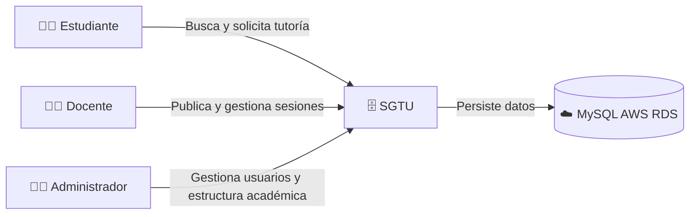
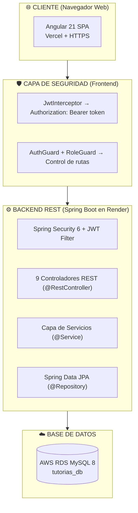
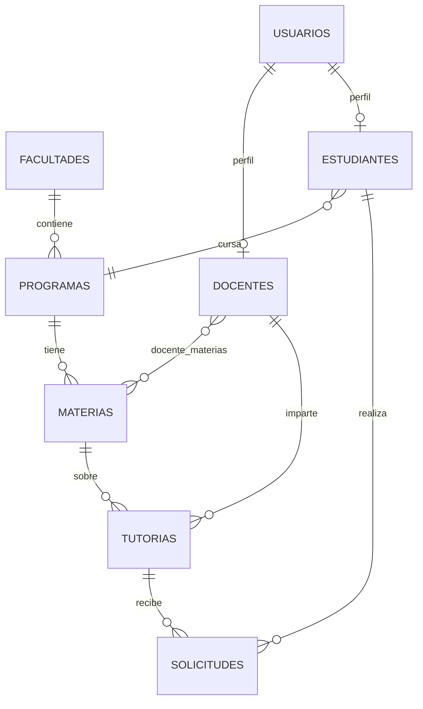
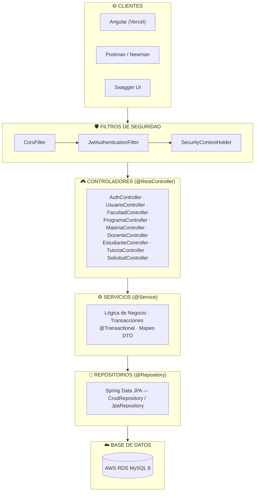
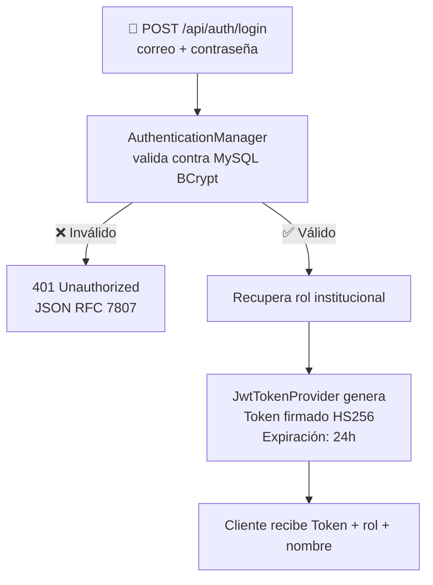
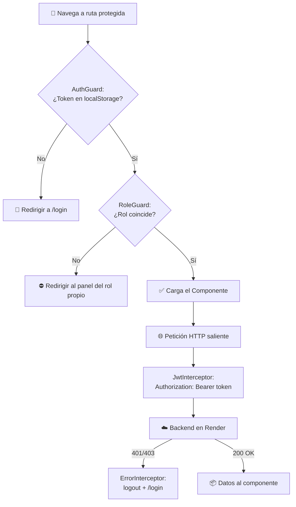
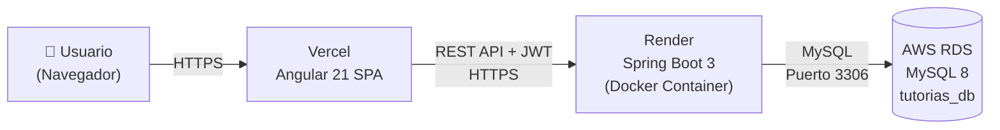

# Documento Técnico Consolidado — Entrega 5
## Sistema de Gestión de Tutorías Universitarias (SGTU)
### Proyecto Final Integrado y Desplegado en la Nube

---

**Curso:** Electiva Profesional II  
**Programa:** Ingeniería de Sistemas  
**Institución:** Corporación Universitaria Antonio José de Sucre (UNIAJS)  
**Profesor:** Jaider de la Rosa Bertel  
**Semana:** 12 — Entrega Final  
**Fecha:** Noviembre 2026

**Repositorio Oficial (Monorepo):** [https://github.com/WRivxs/SGTU-Tutorias-Universitarias](https://github.com/WRivxs/SGTU-Tutorias-Universitarias)  
**Frontend en Producción (Vercel):** [https://sgtu-tutorias-universitarias.vercel.app](https://sgtu-tutorias-universitarias.vercel.app)  
**Backend en Producción (Render):** [https://sgtu-tutorias-universitarias.onrender.com](https://sgtu-tutorias-universitarias.onrender.com)  
**Documentación Swagger UI:** [https://sgtu-tutorias-universitarias.onrender.com/swagger-ui/index.html](https://sgtu-tutorias-universitarias.onrender.com/swagger-ui/index.html)

**Equipo de Desarrollo:**

| Nombre | Rol en el Proyecto |
|---|---|
| **Wadid Rivas Payares** | Arquitectura, Backend e Integración Backend-Frontend |
| **Eduardo Julio Bettin Avilez** | Líder Técnico de Frontend y Experiencia de Usuario (UI/UX) |
| **Azael Espitia Toribio** | Base de Datos, Persistencia y AWS RDS |
| **Jhon Jader Bertel Ortega** | Calidad (QA), Pruebas y Documentación |

---

## Tabla de Contenidos

1. [Resumen Ejecutivo del Proyecto](#1-resumen-ejecutivo-del-proyecto)
2. [Entrega 1 — Requerimientos y Arquitectura del Sistema](#2-entrega-1--requerimientos-y-arquitectura-del-sistema)
3. [Entrega 2 — Modelado de Base de Datos y Backend Inicial](#3-entrega-2--modelado-de-base-de-datos-y-backend-inicial)
4. [Entrega 3 — Backend Completo, Seguridad y Pruebas](#4-entrega-3--backend-completo-seguridad-y-pruebas)
5. [Entrega 4 — Frontend Angular Integrado](#5-entrega-4--frontend-angular-integrado)
6. [Estado Final del Sistema Desplegado](#6-estado-final-del-sistema-desplegado)
7. [Accesos Rápidos y Credenciales para el Evaluador](#7-accesos-rápidos-y-credenciales-para-el-evaluador)

---

## 1. Resumen Ejecutivo del Proyecto

El **Sistema de Gestión de Tutorías Universitarias (SGTU)** es una plataforma web full-stack desarrollada durante el semestre académico 2026-2 en el marco de la asignatura Electiva Profesional II. Su objetivo es **digitalizar y centralizar el proceso de acompañamiento académico** entre estudiantes y docentes tutores en la Corporación Universitaria Antonio José de Sucre (UNIAJS).

### Producto Final Entregado

| Componente | Tecnología | URL en Producción |
|---|---|---|
| **Frontend SPA** | Angular 21 + Tailwind CSS | https://sgtu-tutorias-universitarias.vercel.app |
| **Backend REST API** | Spring Boot 3 + Spring Security 6 + JWT | https://sgtu-tutorias-universitarias.onrender.com |
| **Base de Datos** | MySQL 8 en AWS RDS | `parcial1electiva.cd40okomwyz0.us-east-2.rds.amazonaws.com` |
| **Documentación API** | Swagger / OpenAPI 3 | .../swagger-ui/index.html |
| **Control de Versiones** | Git + GitHub (Monorepo) | github.com/WRivxs/SGTU-Tutorias-Universitarias |

### Métricas del Sistema

- **9 entidades de base de datos** normalizadas hasta 3FN
- **9 controladores REST** con CRUD completo
- **3 roles de acceso** (ADMINISTRADOR, DOCENTE, ESTUDIANTE)
- **53 pruebas automatizadas** con 100% de aprobación (17 unitarias + 36 de integración)
- **14 módulos de vista** en el frontend distribuidos por rol
- **Despliegue CI/CD** automatizado via GitHub → Vercel y GitHub → Render

---

## 2. Entrega 1 — Requerimientos y Arquitectura del Sistema

### 2.1 Descripción del Problema

Las instituciones de educación superior como UNIAJS gestionan sus procesos de tutoría académica de manera manual o mediante medios informales (WhatsApp, correo electrónico), lo que genera:
- Dificultad para que los estudiantes encuentren tutores disponibles en sus asignaturas
- Falta de trazabilidad en las solicitudes y confirmaciones de sesiones
- Ausencia de control de cupos y agendamiento
- Imposibilidad de generar reportes de acompañamiento académico

### 2.2 Solución Propuesta

Plataforma web con **tres perfiles de usuario** y flujo completo de gestión:



### 2.3 Requerimientos Funcionales

| ID | Requerimiento | Rol | Prioridad |
|---|---|---|---|
| RF-01 | El sistema debe permitir autenticación mediante correo y contraseña | Todos | Alta |
| RF-02 | El administrador debe poder crear, editar, activar/desactivar y eliminar usuarios | ADMIN | Alta |
| RF-03 | El administrador debe poder gestionar la estructura académica (facultades, programas, materias) | ADMIN | Alta |
| RF-04 | El docente debe poder crear sesiones de tutoría con fecha, hora, modalidad y cupo máximo | DOCENTE | Alta |
| RF-05 | El docente debe poder aceptar o rechazar solicitudes de inscripción de estudiantes | DOCENTE | Alta |
| RF-06 | El estudiante debe poder buscar y filtrar tutorías disponibles por materia o tutor | ESTUDIANTE | Alta |
| RF-07 | El estudiante debe poder solicitar un cupo en una tutoría disponible | ESTUDIANTE | Alta |
| RF-08 | El estudiante debe poder consultar el estado de sus solicitudes en tiempo real | ESTUDIANTE | Alta |
| RF-09 | El sistema debe controlar automáticamente los cupos de cada sesión | Sistema | Alta |
| RF-10 | El sistema debe generar respuestas de error estandarizadas ante entradas inválidas | Sistema | Media |

### 2.4 Requerimientos No Funcionales

| Categoría | Requerimiento |
|---|---|
| **Seguridad** | Autenticación stateless con JWT firmado HS256, contraseñas cifradas con BCrypt |
| **Disponibilidad** | Sistema desplegado en la nube con HTTPS, disponible 24/7 |
| **Escalabilidad** | Arquitectura en capas desacoplada, lista para crecimiento horizontal |
| **Usabilidad** | Interfaz responsiva compatible con móviles, tablets y escritorio |
| **Trazabilidad** | Timestamps de auditoría en registros de solicitudes y usuarios |

### 2.5 Arquitectura General del Sistema



---

## 3. Entrega 2 — Modelado de Base de Datos y Backend Inicial

### 3.1 Modelo Entidad-Relación (Normalizado hasta 3FN)

El modelo relacional fue diseñado con 9 tablas normalizadas hasta la Tercera Forma Normal (3FN), eliminando dependencias transitivas y redundancias de datos:



### 3.2 Diccionario de Datos — 9 Tablas del Sistema

#### Tabla `facultades`
| Campo | Tipo | Restricciones | Descripción |
|---|---|---|---|
| `id_facultad` | BIGINT | PK, AUTO_INCREMENT | Identificador único |
| `nombre` | VARCHAR(120) | NOT NULL, UNIQUE | Nombre oficial de la facultad |
| `codigo` | VARCHAR(20) | NOT NULL, UNIQUE | Código mnemotécnico (ej. `FAC-ING`) |
| `descripcion` | VARCHAR(255) | NULL | Reseña del área del conocimiento |
| `estado` | BOOLEAN | NOT NULL, DEFAULT TRUE | Estado operativo |

#### Tabla `programas`
| Campo | Tipo | Restricciones | Descripción |
|---|---|---|---|
| `id_programa` | BIGINT | PK, AUTO_INCREMENT | Identificador único |
| `facultad_id` | BIGINT | FK → `facultades` | Facultad a la que pertenece |
| `nombre` | VARCHAR(120) | NOT NULL | Nombre de la carrera |
| `codigo` | VARCHAR(20) | NOT NULL, UNIQUE | Código del programa |
| `descripcion` | VARCHAR(255) | NULL | Perfil curricular |
| `estado` | BOOLEAN | NOT NULL, DEFAULT TRUE | Estado del programa |

#### Tabla `materias`
| Campo | Tipo | Restricciones | Descripción |
|---|---|---|---|
| `id_materia` | BIGINT | PK, AUTO_INCREMENT | Identificador único |
| `programa_id` | BIGINT | FK → `programas` | Programa al que pertenece |
| `nombre` | VARCHAR(120) | NOT NULL | Nombre de la asignatura |
| `codigo` | VARCHAR(20) | NOT NULL, UNIQUE | Código único (ej. `MAT-101`) |
| `semestre` | INT | NOT NULL, CHECK(1..12) | Semestre de la malla curricular |
| `creditos` | INT | NOT NULL, CHECK(1..6) | Créditos académicos |

#### Tabla `usuarios`
| Campo | Tipo | Restricciones | Descripción |
|---|---|---|---|
| `id_usuario` | BIGINT | PK, AUTO_INCREMENT | Identificador único |
| `nombre` | VARCHAR(80) | NOT NULL | Nombre de pila |
| `apellido` | VARCHAR(80) | NOT NULL | Apellido(s) |
| `correo` | VARCHAR(120) | NOT NULL, UNIQUE | Correo institucional (credencial) |
| `password` | VARCHAR(255) | NOT NULL | Hash BCrypt de la contraseña |
| `rol` | ENUM | NOT NULL | `ADMINISTRADOR`, `DOCENTE`, `ESTUDIANTE` |
| `estado` | BOOLEAN | NOT NULL, DEFAULT TRUE | Cuenta activa/suspendida |
| `fecha_registro` | DATETIME | NOT NULL, DEFAULT NOW() | Timestamp de creación |

#### Tabla `docentes`
| Campo | Tipo | Restricciones | Descripción |
|---|---|---|---|
| `id_docente` | BIGINT | PK, AUTO_INCREMENT | Identificador del perfil |
| `usuario_id` | BIGINT | NOT NULL, UNIQUE, FK → `usuarios` | Vínculo 1:1 con cuenta de usuario |
| `especialidad` | VARCHAR(150) | NULL | Áreas de experticia |
| `descripcion` | VARCHAR(255) | NULL | Reseña profesional |

#### Tabla `docente_materias` (N:M)
| Campo | Tipo | Restricciones | Descripción |
|---|---|---|---|
| `docente_id` | BIGINT | FK → `docentes` | Identificador del docente |
| `materia_id` | BIGINT | FK → `materias` | Identificador de la materia |
| **PK** | `(docente_id, materia_id)` | PRIMARY KEY | Evita asignaciones duplicadas |

#### Tabla `estudiantes`
| Campo | Tipo | Restricciones | Descripción |
|---|---|---|---|
| `id_estudiante` | BIGINT | PK, AUTO_INCREMENT | Identificador del perfil |
| `usuario_id` | BIGINT | NOT NULL, UNIQUE, FK → `usuarios` | Vínculo 1:1 con cuenta de usuario |
| `programa_id` | BIGINT | NOT NULL, FK → `programas` | Carrera que cursa |
| `semestre_actual` | INT | NOT NULL, CHECK(1..12) | Semestre lectivo actual |
| `codigo_estudiantil` | VARCHAR(30) | NOT NULL, UNIQUE | Código de matrícula institucional |

#### Tabla `tutorias`
| Campo | Tipo | Restricciones | Descripción |
|---|---|---|---|
| `id_tutoria` | BIGINT | PK, AUTO_INCREMENT | Identificador único |
| `docente_id` | BIGINT | FK → `docentes` | Tutor titular |
| `materia_id` | BIGINT | FK → `materias` | Asignatura de la sesión |
| `fecha` | DATE | NOT NULL | Fecha programada |
| `hora` | TIME | NOT NULL | Hora de inicio |
| `modalidad` | ENUM | NOT NULL | `PRESENCIAL`, `VIRTUAL` |
| `lugar` | VARCHAR(150) | NULL | Aula o enlace de reunión |
| `cupo_maximo` | INT | NOT NULL, DEFAULT 5 | Límite de estudiantes |
| `cupos_ocupados` | INT | NOT NULL, DEFAULT 0 | Contador de inscripciones confirmadas |
| `estado` | ENUM | NOT NULL, DEFAULT 'DISPONIBLE' | `DISPONIBLE`, `OCUPADA`, `CANCELADA`, `FINALIZADA` |

#### Tabla `solicitudes`
| Campo | Tipo | Restricciones | Descripción |
|---|---|---|---|
| `id_solicitud` | BIGINT | PK, AUTO_INCREMENT | Identificador único |
| `estudiante_id` | BIGINT | FK → `estudiantes` | Alumno que solicita |
| `tutoria_id` | BIGINT | FK → `tutorias` | Sesión solicitada |
| `fecha_solicitud` | DATETIME | NOT NULL, DEFAULT NOW() | Timestamp de radicación |
| `estado` | ENUM | NOT NULL, DEFAULT 'PENDIENTE' | `PENDIENTE`, `ACEPTADA`, `RECHAZADA`, `CANCELADA` |
| `mensaje_estudiante` | VARCHAR(255) | NULL | Duda o motivo de la consulta |
| `respuesta_docente` | VARCHAR(255) | NULL | Retroalimentación del tutor |

### 3.3 Despliegue en Amazon Web Services (AWS RDS)

- **Motor:** MySQL Community 8.0.x
- **Clase de instancia:** `db.t3.micro` (Capa Gratuita de AWS)
- **Endpoint:** `parcial1electiva.cd40okomwyz0.us-east-2.rds.amazonaws.com`
- **Puerto:** 3306
- **Base de datos:** `tutorias_db`
- **Seguridad:** Security Group configurado para acceso exclusivo desde el backend en Render mediante variables de entorno cifradas

---

## 4. Entrega 3 — Backend Completo, Seguridad y Pruebas

### 4.1 Stack Tecnológico del Backend

| Componente | Tecnología | Versión | Rol |
|---|---|:---:|---|
| Lenguaje | Java (OpenJDK) | 21 LTS | Lenguaje base |
| Framework | Spring Boot | 3.3.x | Contenedor IoC y autoconfiguración |
| Seguridad | Spring Security | 6.x | Pipeline de autenticación y autorización |
| Tokens JWT | jjwt-api / jjwt-impl | 0.11.5 | Generación y validación de tokens HS256 |
| Cifrado | BCryptPasswordEncoder | 10 rounds | Hash unidireccional de contraseñas |
| Persistencia | Spring Data JPA / Hibernate | 6.x | ORM y repositorios |
| Base de datos | AWS RDS MySQL | 8.0 | Motor relacional en la nube |
| Contenedor | Docker + Render Cloud | — | Despliegue containerizado con HTTPS |
| Documentación | Springdoc / Swagger UI | 2.5.x | OpenAPI 3.0 autogenerada |
| Validaciones | Hibernate Validator (Jakarta) | 8.x | Validación declarativa en DTOs |

### 4.2 Arquitectura en Capas del Backend



### 4.3 Matriz de Control de Acceso RBAC

| Endpoint | Método | Roles Autorizados |
|---|:---:|---|
| `/api/auth/login` | POST | **Público** |
| `/api/usuarios` | GET, POST | `ADMINISTRADOR` |
| `/api/usuarios/{id}` | PUT, DELETE | `ADMINISTRADOR` |
| `/api/facultades` | GET | Autenticado |
| `/api/facultades/**` | POST, PUT, DELETE | `ADMINISTRADOR` |
| `/api/programas` | GET | Autenticado |
| `/api/materias` | GET | Autenticado |
| `/api/materias/**` | POST, PUT, DELETE | `ADMINISTRADOR` |
| `/api/tutorias` | GET | Autenticado |
| `/api/tutorias` | POST, PUT | `ADMINISTRADOR`, `DOCENTE` |
| `/api/solicitudes` | POST | `ESTUDIANTE` |
| `/api/solicitudes/{id}/responder` | PATCH | `ADMINISTRADOR`, `DOCENTE` |
| `/swagger-ui/**` | GET | **Público** |

### 4.4 Flujo de Autenticación JWT



**Payload del Token JWT:**
```json
{
  "sub": "usuario@tutorias.com",
  "id": 1,
  "rol": "ADMINISTRADOR",
  "nombre": "Administrador",
  "iat": 1762624800,
  "exp": 1762711200
}
```

### 4.5 Resultados de Pruebas Automatizadas

| Nivel | Herramienta | Pruebas | Aprobadas | % Éxito |
|---|---|:---:|:---:|:---:|
| Unitarias (Backend) | JUnit 5 + Mockito | 17 | 17 | **100%** |
| Integración API | Postman Runner / Newman | 36 | 36 | **100%** |
| **TOTAL** | | **53** | **53** | **100%** |

**Cobertura de pruebas de integración:**
- ✅ Login exitoso para los 3 roles (200 OK + JWT válido)
- ✅ Login fallido con credenciales incorrectas (401 Unauthorized)
- ✅ CRUD de usuarios, facultades, programas, materias
- ✅ Gestión de tutorías y solicitudes
- ✅ Control RBAC: acceso sin token (401), acceso con rol incorrecto (403)
- ✅ Validación de entrada con cuerpo vacío (400 Bad Request)

### 4.6 Manejo Centralizado de Excepciones (RFC 7807)

Todas las anomalías son capturadas por `GlobalExceptionHandler` y retornan un contrato JSON estandarizado:

```json
{
  "timestamp": "2026-11-08T17:25:30.450",
  "status": 403,
  "error": "Forbidden",
  "message": "Acceso denegado: se requieren privilegios de ADMINISTRADOR",
  "path": "/api/facultades"
}
```

| Excepción | Código HTTP |
|---|:---:|
| `MethodArgumentNotValidException` | 400 Bad Request |
| `BadCredentialsException` / Token expirado | 401 Unauthorized |
| `AccessDeniedException` | 403 Forbidden |
| `ResourceNotFoundException` | 404 Not Found |
| `ConflictException` (correo duplicado, sin cupos) | 409 Conflict |
| Excepción general no controlada | 500 Internal Server Error |

---

## 5. Entrega 4 — Frontend Angular Integrado

### 5.1 Stack Tecnológico del Frontend

| Tecnología | Versión | Rol |
|---|---|---|
| Angular | 21 | Framework SPA con Standalone Components |
| TypeScript | 5.x | Tipado estático estricto |
| Tailwind CSS | 3.x | Diseño responsivo y sistema de utilidades |
| RxJS | 7.x | Gestión de flujos asíncronos con Observables |
| Angular Router | 21 | Enrutamiento con guards y lazy loading |
| HttpClient | Angular 21 | Consumo tipado de endpoints REST |
| ReactiveFormsModule | Angular 21 | Formularios reactivos con validación |

### 5.2 Arquitectura Modular del Frontend

```text
frontend/src/app/
├── core/                        # Núcleo (Singletons)
│   ├── guards/
│   │   ├── auth.guard.ts        # Verifica sesión activa
│   │   └── role.guard.ts        # Verifica rol de usuario
│   ├── interceptors/
│   │   ├── jwt.interceptor.ts   # Inyecta Authorization: Bearer <token>
│   │   └── error.interceptor.ts # Maneja 401/403 → logout automático
│   └── services/
│       ├── auth.service.ts      # Login, logout, localStorage
│       ├── toast.service.ts     # Notificaciones flotantes
│       └── dialog.service.ts    # Modales de confirmación
├── shared/                      # Componentes y modelos reutilizables
│   ├── components/layout/       # Navbar, Sidebar por rol
│   └── models/                  # Interfaces TypeScript (9 modelos)
└── modules/                     # Módulos por rol (Lazy Loading)
    ├── auth/pages/login/        # Portal de autenticación
    ├── admin/pages/             # Dashboard, Usuarios, Facultades, Materias
    ├── tutor/pages/             # Mis Tutorías, Solicitudes, Perfil
    └── estudiante/pages/        # Buscar Tutorías, Mis Solicitudes, Perfil
```

### 5.3 Servicios Angular — Endpoints Consumidos

| Servicio | Endpoints del Backend | Descripción |
|---|---|---|
| `AuthService` | `POST /api/auth/login` | Autenticación y persistencia del JWT |
| `UsuarioService` | `GET/POST/PUT/DELETE /api/usuarios` | CRUD completo de usuarios |
| `FacultadService` | `GET/POST/PUT /api/facultades` | Gestión de facultades |
| `ProgramaService` | `GET/POST /api/programas` | Gestión de programas académicos |
| `MateriaService` | `GET/POST/PUT /api/materias` | Catálogo curricular |
| `DocenteService` | `GET/PUT /api/docentes` | Perfiles de docentes tutores |
| `EstudianteService` | `GET/PUT /api/estudiantes` | Perfiles de estudiantes |
| `TutoriaService` | `GET/POST/PATCH /api/tutorias` | Programación y gestión de sesiones |
| `SolicitudService` | `GET/POST/PATCH/DELETE /api/solicitudes` | Ciclo de vida de solicitudes |

### 5.4 Pipeline de Seguridad en el Frontend



### 5.5 Vistas y Operaciones CRUD por Rol

| Módulo | Vista | Operaciones |
|---|---|---|
| **Admin** | Gestión de Usuarios | Listar, Crear, Editar, Suspender/Activar, Eliminar |
| **Admin** | Gestión de Facultades | Listar, Crear, Modificar |
| **Admin** | Gestión de Materias | Listar (filtros), Crear, Editar |
| **Docente** | Mis Tutorías | Listar, Crear (fecha/hora/cupo/modalidad), Cancelar |
| **Docente** | Solicitudes | Listar, Aceptar, Rechazar |
| **Estudiante** | Buscar Tutorías | Filtrar catálogo, Solicitar Cupo |
| **Estudiante** | Mis Solicitudes | Listar estado, Cancelar solicitud |

### 5.6 Evidencia de Integración Real con el Backend

El frontend **no utiliza ningún dato simulado (mock)**. Toda la información proviene en tiempo real de la API en Render, que a su vez consulta AWS RDS.

**Configuración de producción:**
```typescript
// src/environments/environment.prod.ts
export const environment = {
  production: true,
  apiUrl: 'https://sgtu-tutorias-universitarias.onrender.com/api'
};
```

**Peticiones HTTP reales verificables desde Browser DevTools (F12 → Network):**

| Método | Endpoint | Respuesta |
|---|---|:---:|
| `POST` | `.../api/auth/login` | `200 OK` + JWT |
| `GET` | `.../api/usuarios` | `200 OK` + lista |
| `GET` | `.../api/facultades` | `200 OK` + lista |
| `GET` | `.../api/materias?programaId=1` | `200 OK` + materias |
| `GET` | `.../api/tutorias?estado=DISPONIBLE` | `200 OK` + catálogo |
| `POST` | `.../api/solicitudes` | `201 Created` |
| `PATCH` | `.../api/solicitudes/{id}/estado` | `200 OK` |

[Pegar aquí capturas del Network tab del navegador mostrando peticiones reales a onrender.com]

---

## 6. Estado Final del Sistema Desplegado

### 6.1 Infraestructura en Producción



### 6.2 CI/CD Automatizado

| Plataforma | Disparador | Acción Automática |
|---|---|---|
| **Vercel** | Push a rama `main` (carpeta `/frontend`) | Build Angular → Deploy en Vercel con HTTPS |
| **Render** | Push a rama `main` (carpeta `/backend`) | Build Maven → Docker Build → Deploy con HTTPS |

**El ciclo completo de despliegue toma aproximadamente 3–5 minutos** desde el `git push` hasta que la nueva versión está disponible en producción.

### 6.3 Correcciones y Mejoras de la Entrega Final

| Issue | Descripción | Estado |
|---|---|:---:|
| Cold Start de Render | El backend en el plan gratuito de Render se suspende tras 15 min de inactividad; la primera petición puede tardar ~30s | ✅ Documentado |
| CORS Configuration | Configuración explícita de orígenes autorizados en `WebConfig.java` para Vercel y localhost | ✅ Resuelto |
| JWT Expiration | Token configurado a 24 horas; el `ErrorInterceptor` redirige al login automáticamente al expirar | ✅ Implementado |
| Validación de cupos | Transacción atómica `@Transactional` al aceptar solicitudes evita sobreventa de cupos | ✅ Implementado |

### 6.4 Resultados Finales del Sistema

| Métrica | Valor |
|---|---|
| Endpoints REST funcionales | 9 controladores, ~40 endpoints |
| Pruebas automatizadas aprobadas | 53/53 (100%) |
| Vistas del frontend | 14 módulos de página |
| Roles de usuario | 3 (ADMINISTRADOR, DOCENTE, ESTUDIANTE) |
| Tablas en base de datos | 9 (normalizadas hasta 3FN) |
| Tiempo promedio de respuesta API | < 500ms (backend activo) |
| Despliegue CI/CD | ✅ Activo (Vercel + Render) |

---

## 7. Accesos Rápidos y Credenciales para el Evaluador

### 7.1 URLs del Sistema

| Recurso | URL |
|---|---|
| **Frontend (Producción)** | https://sgtu-tutorias-universitarias.vercel.app |
| **Backend + Swagger UI** | https://sgtu-tutorias-universitarias.onrender.com/swagger-ui/index.html |
| **Repositorio GitHub** | https://github.com/WRivxs/SGTU-Tutorias-Universitarias |
| **Código fuente Frontend** | https://github.com/WRivxs/SGTU-Tutorias-Universitarias/tree/main/frontend |
| **Código fuente Backend** | https://github.com/WRivxs/SGTU-Tutorias-Universitarias/tree/main/backend |

### 7.2 Credenciales de Demostración

| Rol | Email | Contraseña |
|---|---|---|
| **ADMINISTRADOR** | `admin@tutorias.com` | `Admin123*` |
| **DOCENTE** | `wadid.docente@tutorias.com` | `Docente123*` |
| **ESTUDIANTE** | `ana.estudiante@tutorias.com` | `Estudiante123*` |

### 7.3 Ejecución de Pruebas con Newman (Línea de Comandos)

```bash
# Instalar Newman (una sola vez)
npm install -g newman

# Ejecutar suite completa contra el backend en Render
npx newman run backend/postman/SGTU-API-Entrega3.postman_collection.json \
  -e backend/postman/SGTU-Render.postman_environment.json \
  --reporters cli
```

### 7.4 Verificación de Integración Real (Browser DevTools)

1. Abrir https://sgtu-tutorias-universitarias.vercel.app
2. Presionar `F12` → pestaña **Red / Network** → filtrar por **Fetch/XHR**
3. Iniciar sesión con cualquier credencial de demostración
4. Verificar que todas las peticiones van a `sgtu-tutorias-universitarias.onrender.com` con Status `200 OK`
5. Hacer clic en cualquier petición → pestaña **Headers** → verificar `Authorization: Bearer eyJhbGci...`

---

*Documento Técnico Consolidado — SGTU — Electiva Profesional II, UNIAJS, Noviembre 2026.*  
*Elaborado por: Wadid Rivas Payares, Eduardo Julio Bettin Avilez, Azael Espitia Toribio, Jhon Jader Bertel Ortega.*
